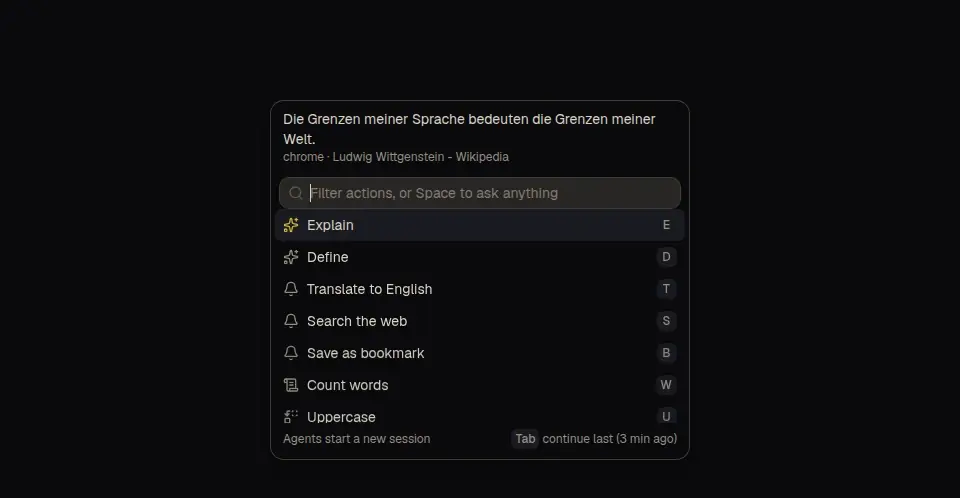

# pluck

Select text in any app, press a hotkey, and send it to your own scripts or an AI agent from a small menu at the cursor.

**[Try it in your browser](https://pluck.soleone.xyz)** · [Download for Windows](https://github.com/Soleone/pluck/releases/latest)



## What it does

Every action is one entry in a config file. An action either runs a command, which gets the selected text on stdin, or sends a prompt to an agent. Its output can stream into a small panel, go to the clipboard, show as a notification, or replace the selection. Anything a script can do (translate, look up, bookmark, reformat) becomes a keystroke from any app.

- **Fast:** the menu opens at the cursor in under 100 ms. Each action has a key, so `Ctrl+Alt+Space`, `E` runs Explain.
- **Ask anything:** type a question instead of picking an action, and an agent gets it along with the selected text, the app and the page it came from.
- **Agent sessions:** agent actions open a chat window with the reply streaming in and each web search or tool call shown as a step. Pluck drives the harness you already use, [Pi](https://github.com/badlogic/pi-mono), Claude Code or Codex, so the models, logins and extensions you set up just work.
- **Yours:** actions are plain scripts in your config folder. Pluck writes a few samples on first start.

## Get it

Windows: download the installer from the [latest release](https://github.com/Soleone/pluck/releases/latest). It installs per user and updates itself. Windows may warn about an unknown publisher on first run.

macOS and Linux (Hyprland) are next. On Linux, Wayland doesn't allow global hotkeys, so you bind `pluck menu` in your window manager instead.

## Actions

Actions live in `pluck.toml` in pluck's config folder (`%APPDATA%\pluck` on Windows). Home's Actions tab edits them too.

```toml
[[action]]
id = "explain"
name = "Explain"
key = "e"
agent = "Explain this briefly."

[[action]]
id = "upper"
name = "Uppercase"
key = "u"
run = 'powershell.exe -NoProfile -File scripts/upper.ps1'
output = "replace"
```

- `run` is a command. It gets the text on stdin and in `PLUCK_TEXT`, plus `PLUCK_APP`, `PLUCK_TITLE` and `PLUCK_URL`.
- `agent` is a prompt instead. Add `model` or `thinking` to override the defaults from Settings.
- `output` is `show`, `copy`, `notify`, `replace` or, for agents, `session`.

Scripts can run in WSL: check Run in WSL in Settings. The full behavior is in [spec/](spec/README.md).

## Your data

Pluck reads the selection only when you press the hotkey. If it has to copy it through the clipboard, it puts your clipboard back afterwards. Nothing leaves your machine except what your own scripts and agent send, and pluck's own check for updates on GitHub.

## Development

```sh
pnpm install
pnpm dev:web   # the UI in a browser with sample data (also the hosted demo)
pnpm dev       # the native app, built for the OS it runs on
```

`pnpm build:tauri` builds the installer, and `pnpm media:capture` records the demo loop above. See [AGENTS.md](AGENTS.md) for checks and releasing.
